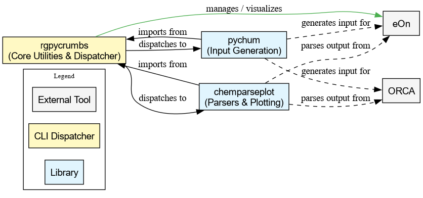

Generates input files for single computational chemistry runs from unified TOML inputs, including jobflow and Fireworks workflows.

# Table of Contents

-   [About](#org2e7287d)
    -   [Ecosystem Overview](#org408bcb3)
    -   [Features](#orgaa2c716)
    -   [Rationale](#org8edc525)
-   [Usage](#org6e90d5c)
-   [Development](#org326bcbc)
    -   [Adding ORCA blocks](#org2f7b52f)
    -   [Documentation](#org30955ec)
-   [License](#org24b59f5)

# About

A **pure-python** project to generate input files for various common
computational chemistry workflows. This means:

-   Generating input structures for `jobflow` / Fireworks
    -   From unified `toml` inputs
-   ORCA blocks (NEB, geometry scans, extras) and eOn renderers via Jinja templates
-   Shared units and helpers with [`rgpycrumbs`](https://github.com/HaoZeke/rgpycrumbs) (`rgpycrumbs>=1.10.4`). Suite pins/config live in **rgpkgs** (`~/.config/rgpkgs/config.toml`, project `rgpkgs.toml`) — pychum does not define its own pin file

This is a spin-off from `wailord` ([here](https://wailord.xyz)). **Tool split:**

-   **`pychum`** — sole path for **single-run input generation** (ORCA Jinja/TOML,
    NWChem socket for eOn). Prefer `pychum` over wailord `inpGenerator`.
-   **`chemparseplot`** — sole path for **parsing and plotting outputs** (including
    ORCA NEB via a public API that may use OPI internally; do not depend on `opi`
    directly).
-   **`wailord`** — optional **batch/experiment** orchestration only; should call
    pychum + chemparseplot rather than reimplement ORCA I/O.

It is a companion to [`chemparseplot`](https://github.com/HaoZeke/chemparseplot)
(v1.8+ recommended) for uniform visualizations of computational chemistry outputs. Install with `pip install pychum` (Python ≥3.10); develop with `pixi run -e test test` or `uv sync --extra test`.

## Ecosystem Overview

`pychum` is part of the `rgpycrumbs` suite of interlinked libraries.

## Features

-   Jobflow support
    -   Along with Fireworks
-   Unit aware conversions
    -   Via `pint`

### Supported Engines

-   NEB calculations
    -   ORCA
    -   EON
-   Single point calculations
    -   ORCA
    -   EON

## Rationale

I needed to run a bunch of systems. `jobflow` / Fireworks / AiiDA were ideal,
until I realized only VASP is really well supported by them.

Also there were some minor problems with the ORCA input parser&#x2026;

-   It chokes on multiple `#` symbols, so `# MaxIter 50 # something` will error
    out on `SOMETHING`
-   No real ordering or syntax highlighting in major IDEs

Along with other minor inconveniences which make for enough friction over time
to necessitate this library.

# Usage

The simplest usage is via the CLI:

    uv run pychum --help
    # Or alternatively
    python -m pychum.cli --help

# Development

Before writing tests and incorporating the functions into the CLI it is helpful
to often visualize the intermediate steps. For this we can setup a complete
development environment including the notebook server.

    uv sync --all-extras
    uv run jupyter lab --ServerApp.allow_remote_access=1 \
        --ServerApp.open_browser=False --port=8889

Then go through the `nb` folder notebooks.

## Adding ORCA blocks

Changes are to be made in the following files under the `pychum/engine/orca/` folder:

-   The relevant `.jinja` file in the `_blocks` directory
-   The configuration loading mechanism in `config_loader.py`
-   The `dataclasses` folder
-   A sample test `.toml` file under `tests/test_orca`

While working on this, it may be instructive to use the `nb` folder notebooks.
Also all PRs must include a full test suite for the new blocks.

## Documentation

### Readme

The `readme` can be constructed via:

    ./scripts/org_to_md.sh readme_src.org readme.md

# License

MIT. However, this is an academic resource, so **please cite** as much as possible
via:

-   The Zenodo DOI for general use.
-   The `wailord` paper for ORCA usage

