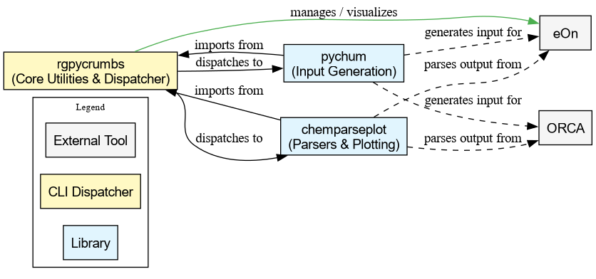

#+OPTIONS: num:nil toc:nil

Generates input files for single computational chemistry runs from unified TOML inputs, including jobflow and Fireworks workflows.

#+TOC: headlines 2

* About
file:branding/logo/pychum_logo.png
#+begin_export markdown

#+end_export
A *pure-python* project to generate input files for various common
computational chemistry workflows. This means:
- Generating input structures for ~jobflow~ / Fireworks
  + From unified ~toml~ inputs
- ORCA blocks (NEB, geometry scans, extras) and eOn renderers via Jinja templates
- Shared units and helpers with [[https://github.com/HaoZeke/rgpycrumbs][~rgpycrumbs~]] (~rgpycrumbs>=1.10.4~). Suite pins/config live in *rgpkgs* (=~/.config/rgpkgs/config.toml=, project ~rgpkgs.toml~) — pychum does not define its own pin file

This is a spin-off from ~wailord~ ([[https://wailord.xyz][here]]). *Tool split:*

- *~pychum~* — sole path for *single-run input generation* (ORCA Jinja/TOML,
  NWChem socket for eOn). Prefer ~pychum~ over wailord ~inpGenerator~.
- *~chemparseplot~* — sole path for *parsing and plotting outputs* (including
  ORCA NEB via a public API that may use OPI internally; do not depend on ~opi~
  directly).
- *~wailord~* — optional *batch/experiment* orchestration only; should call
  pychum + chemparseplot rather than reimplement ORCA I/O.

It is a companion to [[https://github.com/HaoZeke/chemparseplot][~chemparseplot~]]
(v1.8+ recommended) for uniform visualizations of computational chemistry outputs. Install with ~pip install pychum~ (Python ≥3.10); develop with ~pixi run -e test test~ or ~uv sync --extra test~.

** Ecosystem Overview
   ~pychum~ is part of the ~rgpycrumbs~ suite of interlinked libraries.

** Features
- Jobflow support
  + Along with Fireworks
- Unit aware conversions
  + Via ~pint~
*** Supported Engines
- NEB calculations
  + ORCA
  + EON
- Single point calculations
  + ORCA
  + EON
** Rationale
I needed to run a bunch of systems. ~jobflow~ / Fireworks / AiiDA were ideal,
until I realized only VASP is really well supported by them.

Also there were some minor problems with the ORCA input parser...
- It chokes on multiple ~#~ symbols, so ~# MaxIter 50 # something~ will error
  out on ~SOMETHING~
- No real ordering or syntax highlighting in major IDEs

Along with other minor inconveniences which make for enough friction over time
to necessitate this library.
* Usage
The simplest usage is via the CLI:
#+begin_src bash
uv run pychum --help
# Or alternatively
python -m pychum.cli --help
#+end_src
* Development
Before writing tests and incorporating the functions into the CLI it is helpful
to often visualize the intermediate steps. For this we can setup a complete
development environment including the notebook server.
#+begin_src bash
uv sync --all-extras
uv run jupyter lab --ServerApp.allow_remote_access=1 \
    --ServerApp.open_browser=False --port=8889
#+end_src
Then go through the ~nb~ folder notebooks.
** Adding ORCA blocks
Changes are to be made in the following files under the ~pychum/engine/orca/~ folder:
- The relevant ~.jinja~ file in the ~_blocks~ directory
- The configuration loading mechanism in ~config_loader.py~
- The ~dataclasses~ folder
- A sample test ~.toml~ file under ~tests/test_orca~
While working on this, it may be instructive to use the ~nb~ folder notebooks.
Also all PRs must include a full test suite for the new blocks.
** Documentation
*** Readme
The ~readme~ can be constructed via:
#+begin_src bash
./scripts/org_to_md.sh readme_src.org readme.md
#+end_src
* License
MIT. However, this is an academic resource, so *please cite* as much as possible
via:
- The Zenodo DOI for general use.
- The ~wailord~ paper for ORCA usage

# ** Logo
# The logo was generated via DALL-E accessed through ChatGPT-4 using a prompt.
